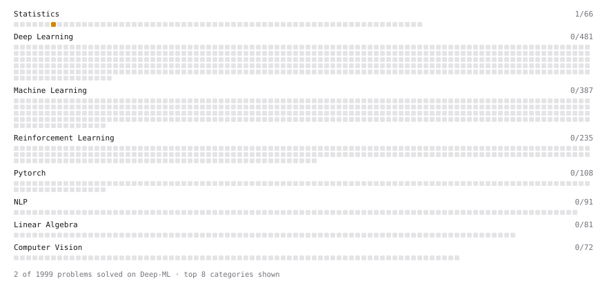

# Deep-ML

My machine learning practice from [Deep-ML](https://www.deep-ml.com). Every solution here was written by hand.

**2** solved · 2 problems · 0 labs · 0 math

[**Browse the interactive portfolio**](https://baner175.github.io/deep-ml/) to replay this filling in over time.

## Problems

| | Difficulty | Solved | |
| --- | --- | --- | --- |
| [Confidence Interval for Population Mean](https://www.deep-ml.com/problems/212) | medium | 2026-11-12 | [solution](problems/0212-confidence-interval-for-population-mean) |
| [Jensen-Shannon Divergence](https://www.deep-ml.com/problems/203) | medium | 2026-11-12 | [solution](problems/0203-jensen-shannon-divergence) |

---

_This file is regenerated by Deep-ML on every push._
